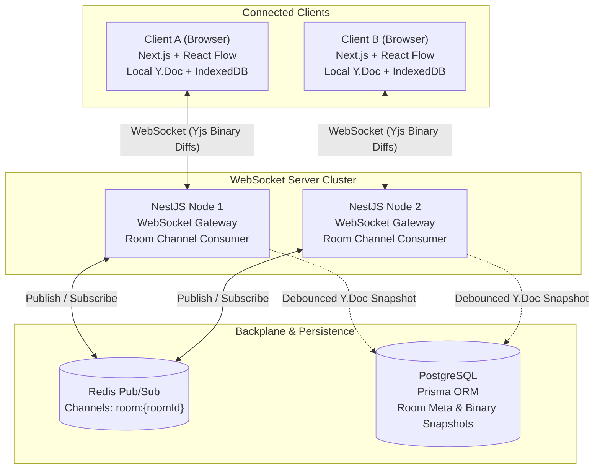

# CollabArch

> **Real-Time Collaborative Architecture Canvas & Interactive Network Simulator**

CollabArch is a distributed, real-time system design studio where engineering teams collaboratively model cloud architectures (API Gateways, Microservices, Message Brokers, Databases) and simulate traffic dynamics in real-time.

It eliminates collaborative race conditions using Conflict-Free Replicated Data Types (CRDTs), scales real-time WebSocket communication horizontally across node clusters using Redis Pub/Sub, supports offline-first diagramming with local IndexedDB persistence, and features an in-browser discrete-event simulation engine to visualize bottlenecks, queue saturation, and dropped packets.

---

## Architecture Overview



---

## Core System Capabilities

### 1. Lock-Free State Convergence (CRDTs)
* Uses **Yjs** (`Y.Doc`) to model canvas topology (`nodes` and `edges` stored in shared `Y.Map` collections).
* Nodes and connections can be concurrently created, mutated, or deleted without distributed locking or central arbitration.
* Strong Eventual Consistency is mathematically guaranteed across all active replicas.

### 2. Horizontally Scalable WebSocket Mesh
* Built on a **NestJS WebSocket Gateway** cluster.
* Node instances decouple active socket connections from room broadcast logic via **Redis Pub/Sub**.
* When a client mutates the diagram, the receiving node publishes the raw binary delta update to `room:<roomId>`, fanning out instantly to all server instances hosting sockets for that room.

### 3. Offline-First Resilience & Delta Sync
* Local state persists to client-side storage via **IndexedDB** (`y-indexeddb`).
* When connection drops, engineers can continue creating and modifying architecture components locally.
* On reconnection, Yjs exchanges state vectors (`Y.encodeStateVector`) and transmits only missing binary deltas, minimizing bandwidth and resolving partition divergences seamlessly.

### 4. Interactive Traffic Simulation Engine
* Client-side discrete-event loop simulating network traffic over the graph.
* Configurable node parameters:
  * **Throughput Capacity (RPS)**
  * **Processing Latency (ms)**
  * **Queue Buffer Depth & Drop Policies (FIFO, Drop-Tail)**
* Visual packet animations and metrics overlay showing queue backpressure, saturated bottlenecks, and error rates in real-time.

---

## Tech Stack

| Layer | Technology | Purpose |
|---|---|---|
| **Monorepo** | Turborepo / pnpm | Workspaces for unified type sharing and tooling |
| **Frontend** | Next.js (App Router), React | Modern reactive web application |
| **Canvas** | React Flow / Canvas API | Interactive node-edge graph interface |
| **Styling** | Tailwind CSS, Shadcn UI, Lucide Icons | Design system & architecture component styling |
| **Local State / UI** | Zustand | Canvas viewport, UI modals, simulation state |
| **CRDT Engine** | `yjs`, `y-websocket`, `y-indexeddb` | Decentralized collaborative state engine |
| **Backend** | NestJS, WebSocket Gateway (`ws` / `socket.io`) | Scalable real-time gateway and REST API |
| **Pub/Sub** | Redis | Cross-server room event mesh |
| **Persistence** | PostgreSQL, Prisma ORM | Relational metadata & debounced Yjs binary documents |
| **Dev Environment** | Docker Compose | Local containerized PostgreSQL and Redis |

---

## Repository Structure

```text
collabarch/
├── apps/
│   ├── web/                    # Next.js frontend application
│   │   ├── src/
│   │   │   ├── app/            # App Router pages and layouts
│   │   │   ├── components/     # React Flow custom nodes, toolbar, canvas
│   │   │   ├── hooks/          # useCollabCanvas, usePresence, useSimulation
│   │   │   ├── lib/            # Yjs setup, indexeddb provider, simulation engine
│   │   │   └── store/          # Zustand UI and simulation state
│   │   └── package.json
│   └── server/                 # NestJS real-time backend
│       ├── src/
│       │   ├── gateway/        # WebSocket Gateway & room manager
│       │   ├── redis/          # Redis Pub/Sub adapter & service
│       │   ├── rooms/          # Room persistence and metadata controller
│       │   └── prisma/         # Prisma schema and client
│       └── package.json
├── packages/
│   └── shared-types/           # Common interfaces, DTOs, and component models
│       ├── src/
│       │   ├── canvas.ts       # Architecture node & edge type definitions
│       │   ├── simulation.ts   # Packet, queue, and metrics interfaces
│       │   └── events.ts       # WebSocket & Redis payload structures
│       └── package.json
├── docker-compose.yml          # PostgreSQL & Redis infrastructure
├── turbo.json                  # Turborepo task pipeline
└── package.json                # Workspace configuration
```

---

## Roadmap & Milestone Phases

- [ ] **Phase 1: Infinite Canvas & Architecture Component Palette**
  - Scaffold monorepo workspaces and shared types.
  - Implement canvas with React Flow (custom nodes: API Gateway, Microservice, Database, Queue).
  - Setup local Zustand state for component configuration and inspector panel.

- [ ] **Phase 2: Yjs Multiplayer Sync & NestJS Gateway**
  - Integrate `yjs` Y.Doc binding to React Flow graph state.
  - Build NestJS WebSocket Gateway supporting room join/leave and binary delta relays.
  - Implement presence awareness (multiplayer live cursors, active node selections).

- [ ] **Phase 3: Clustered Redis Pub/Sub & Offline Sync**
  - Integrate Redis Pub/Sub backplane across NestJS gateway instances.
  - Add client-side `y-indexeddb` provider for offline diagramming and reconnection synchronization.
  - Implement debounced server snapshotting to PostgreSQL via Prisma.

- [ ] **Phase 4: Interactive Traffic Simulation Engine & Visual Polish**
  - Implement discrete-event simulation runner calculating traffic arrival, processing, and queuing.
  - Render animated request packets flowing through edges.
  - Add real-time metrics dashboards (latency percentiles, queue depths, packet drops).
