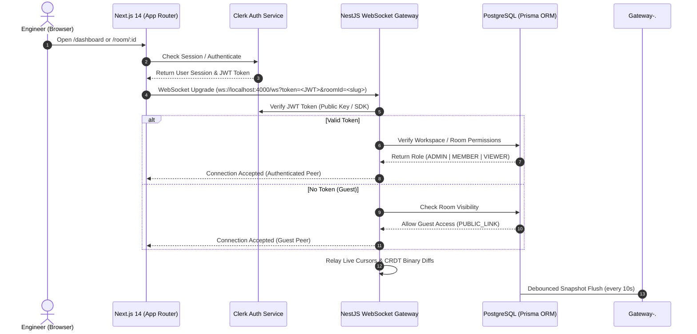

# CollabArch — Enterprise Workspaces, User Management & Clerk Auth Specification

> **Architectural Pattern**: Figma & Eraser.io Hybrid Model  
> **Authentication**: Clerk (`@clerk/nextjs` + NestJS JWT Verification)  
> **Persistence**: PostgreSQL 16 + Prisma ORM  
> **Real-Time Mesh**: Yjs CRDTs + Clustered Redis Pub/Sub + NestJS WebSocket Gateway  

---

## 1. Executive Architecture & Design Philosophy

Engineering teams require persistent, accountable, and secure collaboration. Rather than relying on anonymous throwaway links (the pure Excalidraw model), CollabArch adopts the **Figma & Eraser.io Hybrid Architecture**:

1. **Persistent Ownership & Workspaces**: Every system design canvas belongs to a user or a team workspace, persisted in PostgreSQL with debounced CRDT binary snapshots.
2. **Verified Identity**: Real-time cursors and collaborator avatars display verified identities, Google/GitHub profile pictures, and assigned roles.
3. **Role-Based Access Control (RBAC)**: Workspace owners manage permissions (`ADMIN`, `MEMBER`, `VIEWER`). External stakeholders can be granted view-only or public edit access via share links.
4. **Seamless Guest Fallback**: Anyone opening a public canvas link without an account can join as an authorized guest editor without hitting an aggressive signup paywall.

---

## 2. System Architecture & Auth Flow



---

## 3. Database Schema (Prisma ORM)

File path: `apps/server/prisma/schema.prisma`

```prisma
datasource db {
  provider = "postgresql"
  url      = env("DATABASE_URL")
}

generator client {
  provider = "prisma-client-js"
}

// Verified User Account synced from Clerk
model User {
  id            String            @id // Matches Clerk User ID (e.g. "user_2aBc...")
  email         String            @unique
  name          String
  avatarUrl     String?
  createdAt     DateTime          @default(now())
  updatedAt     DateTime          @updatedAt

  // Relationships
  ownedRooms    CanvasRoom[]      @relation("RoomOwner")
  memberships   WorkspaceMember[]

  @@index([email])
}

// Team / Organization Workspace
model Workspace {
  id            String            @id @default(cuid())
  name          String            // e.g. "Core Infrastructure Team"
  slug          String            @unique
  clerkOrgId    String?           @unique // Optional sync with Clerk Organizations
  createdAt     DateTime          @default(now())
  updatedAt     DateTime          @updatedAt

  members       WorkspaceMember[]
  rooms         CanvasRoom[]

  @@index([slug])
}

// Workspace Membership & Roles
model WorkspaceMember {
  id            String      @id @default(cuid())
  userId        String
  workspaceId   String
  role          Role        @default(MEMBER)
  createdAt     DateTime    @default(now())

  user          User        @relation(fields: [userId], references: [id], onDelete: Cascade)
  workspace     Workspace   @relation(fields: [workspaceId], references: [id], onDelete: Cascade)

  @@unique([userId, workspaceId])
}

// Architecture Canvas Diagrams
model CanvasRoom {
  id            String      @id @default(cuid())
  slug          String      @unique // e.g. "order-service-v2"
  title         String      @default("Untitled Architecture Canvas")
  description   String?
  
  ownerId       String
  workspaceId   String?
  
  // Real-time State & Persistence
  documentBlob  Bytes?      // Debounced binary snapshot of Y.Doc
  visibility    Visibility  @default(WORKSPACE)
  
  createdAt     DateTime    @default(now())
  updatedAt     DateTime    @updatedAt

  owner         User        @relation("RoomOwner", fields: [ownerId], references: [id], onDelete: Cascade)
  workspace     Workspace?  @relation(fields: [workspaceId], references: [id], onDelete: SetNull)

  @@index([slug])
  @@index([ownerId])
  @@index([workspaceId])
}

enum Role {
  ADMIN
  MEMBER
  VIEWER
}

enum Visibility {
  PRIVATE      // Only the owner can access
  WORKSPACE    // Any member in the workspace can access
  PUBLIC_LINK  // Anyone with the shareable URL can access
}
```

---

## 4. Frontend Application Structure (`apps/web`)

```text
apps/web/src/
├── app/
│   ├── (auth)/
│   │   ├── sign-in/[[...sign-in]]/page.tsx   # Clerk SignIn Component
│   │   └── sign-up/[[...sign-up]]/page.tsx   # Clerk SignUp Component
│   ├── (dashboard)/
│   │   ├── dashboard/page.tsx               # Grid of saved architecture diagrams
│   │   └── layout.tsx                       # Dashboard navigation & workspace selector
│   ├── room/
│   │   └── [roomId]/page.tsx                # The Studio (Whiteboard + Simulator)
│   ├── layout.tsx                           # ClerkProvider wrapper
│   └── page.tsx                             # Landing page & quick redirect
├── components/
│   ├── dashboard/
│   │   ├── CreateCanvasModal.tsx            # Modal to name and initialize a diagram
│   │   ├── CanvasCard.tsx                   # Preview card with last-edited timestamp
│   │   └── WorkspaceSwitcher.tsx            # Clerk organization / workspace picker
│   └── toolbar/
│       ├── CanvasToolbar.tsx                # Studio header with UserButton & Share dialog
│       └── ShareModal.tsx                   # RBAC & Public Link sharing controls
```

---

## 5. Backend WebSocket Authentication & JWT Verification (`apps/server`)

### Clerk JWT Verification in NestJS Gateway
When the client initiates the WebSocket connection:
```typescript
// Client-side connection setup (apps/web)
const token = await session.getToken();
const ws = new WebSocket(`ws://localhost:4000/ws?token=${token}&roomId=${roomId}`);
```

In the NestJS WebSocket Gateway:
```typescript
// Server-side authentication guard (apps/server/src/gateway/canvas.gateway.ts)
async handleConnection(client: WebSocket, request: IncomingMessage) {
  const url = new URL(request.url || '', 'http://localhost:4000');
  const token = url.searchParams.get('token');
  const roomId = url.searchParams.get('roomId');

  let user = null;
  if (token) {
    try {
      // Verify Clerk JWT token using Clerk Backend SDK
      const verifiedClaims = await verifyToken(token, {
        secretKey: process.env.CLERK_SECRET_KEY,
      });
      user = {
        userId: verifiedClaims.sub,
        userName: verifiedClaims.name || 'Architect',
        email: verifiedClaims.email,
        avatarUrl: verifiedClaims.picture,
        isGuest: false,
      };
    } catch (err) {
      this.logger.warn(`Invalid or expired Clerk token, falling back to guest`);
    }
  }

  // Fallback to ephemeral guest identity if unauthenticated
  if (!user) {
    user = {
      userId: `guest-${randomUUID().slice(0, 6)}`,
      userName: `Guest (${randomUUID().slice(0, 4)})`,
      avatarUrl: null,
      isGuest: true,
    };
  }

  // Register socket with verified identity in RoomManager
  this.roomManager.registerPeer(client, roomId, user);
}
```

---

## 6. Debounced Snapshot Persistence Strategy

To prevent database write amplification from high-frequency edits:

1. **In-Memory Convergence**: Edits commit instantly to the in-memory `Y.Doc` on port `4000`.
2. **Trailing Debounce (10 Seconds)**:
   ```typescript
   private scheduleRoomSnapshot(roomId: string): void {
     if (this.snapshotTimers.has(roomId)) {
       clearTimeout(this.snapshotTimers.get(roomId));
     }

     const timer = setTimeout(async () => {
       const session = this.rooms.get(roomId);
       if (!session) return;

       const snapshotBuffer = Buffer.from(Y.encodeStateAsUpdate(session.doc));
       await this.prisma.canvasRoom.update({
         where: { slug: roomId },
         data: {
           documentBlob: snapshotBuffer,
           updatedAt: new Date(),
         },
       });
       this.logger.log(`[Persistence] Flushed snapshot for room "${roomId}" to PostgreSQL`);
     }, 10000); // 10s trailing debounce

     this.snapshotTimers.set(roomId, timer);
   }
   ```
3. **Cold-Start Hydration**: When a user opens an inactive room, the backend reads `documentBlob` from PostgreSQL, applies it to a fresh `Y.Doc`, and streams it down to the client.

---

## 7. Implementation Roadmap & Milestones

- [ ] **Milestone 1: Clerk Auth Integration & User Sync**
  - Install `@clerk/nextjs` in `apps/web` and configure middleware.
  - Add `<SignIn />`, `<SignUp />`, and `<UserButton />` components.
  - Sync Clerk users into PostgreSQL on first sign-in via Webhook or post-auth hook.

- [ ] **Milestone 2: Prisma Models & PostgreSQL Migrations**
  - Initialize Prisma in `apps/server/prisma`.
  - Run initial migration against local PostgreSQL (`localhost:5433`).
  - Wire PrismaService into NestJS backend modules.

- [ ] **Milestone 3: Studio Dashboard (`/dashboard`)**
  - Build dashboard view with grid cards of saved diagrams.
  - "New Architecture Canvas" flow creating a database record and routing to `/room/[slug]`.
  - Quick action to duplicate, rename, or delete existing canvases.

- [ ] **Milestone 4: Authenticated WebSocket & Share Permissions**
  - Pass Clerk session token during WebSocket handshake.
  - Verify tokens on the NestJS gateway and broadcast verified user avatars.
  - Implement the "Share Canvas" dialog with View-Only vs. Editor link controls.
